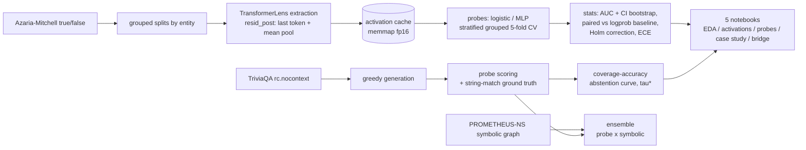

# CASSANDRA

Hallucination detection from internal signals: linear probes trained on residual-stream activations of small open-source models (GPT-2, Pythia-410M) predict whether a statement is factual. The probes are evaluated with grouped cross-validation (by entity), paired bootstrap statistics against a logprob baseline, Holm-Bonferroni correction, calibration analysis, and a selective-abstention curve on free-form generations over TriviaQA. An optional ensemble combines the probe with the symbolic consistency graph of PROMETHEUS-NS.

The statistical showcase lives in four executable notebooks (local Jupyter or Google Colab), committed already executed.

## Architecture



## Repository layout

```text
cassandra_ns/
  config.py               load + validate config.yaml
  data/                   dataset loader, grouped splits, EDA helpers
  activations/            TransformerLens extraction + fp16 memmap cache
  probes/                 training, evaluation, calibration, statistics (stats.py is an anchor)
  generation/             TriviaQA generation + scoring + abstention
  ensemble/               optional symbolic bridge to PROMETHEUS-NS
  report/                 table + figure builders used by the notebooks
notebooks/                01 EDA, 02 activations, 03 probe evaluation, 04 case study
scripts/                  CLI entry points + notebook generation + colab setup
tests/                    structural, split, cache, statistical and ensemble contracts
```

## Quickstart (local, CPU)

```bash
make setup        # python3 -m venv .venv + pinned deps + spaCy model
make data         # downloads datasets, builds folds.json (committed anchor)
make extract      # activations for gpt2 + pythia-410m (idempotent, resumable)
make probe        # grouped-CV probes over the pre-registered grid
make report       # tables + figures from out-of-fold predictions
make generate     # TriviaQA generations + scoring + abstention
make notebooks    # (re)generate the 5 notebooks and execute them headless
make ensemble     # symbolic ensemble eval against the wired PROMETHEUS-NS graph
make test         # all contracts green (42 tests)
```

The resolved environment of the reference run is recorded in `requirements.freeze.txt` (Python 3.10.21, torch 2.4.1+cpu, transformer-lens 2.15.0, transformers 4.46.3). On this reference machine the venv was pinned to Python 3.10 via `uv venv --python 3.10 .venv` for exact spec fidelity; `make setup` reproduces the same pins with any Python 3.10+ interpreter as `python3`.

## Quickstart (Google Colab)

1. Push this repository to a public GitHub repository.
2. Open any notebook in `notebooks/` at colab.research.google.com.
3. Run cell 1: it detects Colab, clones the repo, installs pinned deps and prepares data. To accelerate Pythia extraction: Runtime > Change runtime type > GPU, BEFORE running cell 1.
4. Run the remaining cells in order. The activation cache is idempotent by statement sha256: if the runtime restarts mid-extraction, re-running the guard cell continues where it stopped.

To preview the exact setup cell locally: `make colab`.

## Measured metrics

Every number below comes from an executed run whose artifacts live in `logs/` (out-of-fold predictions, probe results, abstention records). Statement-level probes: grouped 5-fold CV by entity, seed 42, 1000-resample percentile bootstrap.

| Metric | gpt2 | pythia-410m |
|---|---|---|
| best layer (configuration) | 5 (mean_pool, MLP) | 11 (last_token, MLP) |
| AUC (95% CI bootstrap) | 0.728 [0.716, 0.740] | 0.796 [0.784, 0.807] |
| average precision | 0.737 | 0.806 |
| ECE / Brier (probe scores as probabilities) | 0.061 / 0.214 | 0.072 / 0.188 |
| AUC baseline \|mean logprob\| | 0.433 | 0.400 |
| paired diff AUC (probe - baseline), 95% CI | +0.295 [+0.276, +0.315] | +0.396 [+0.378, +0.414] |
| Holm-adjusted p (probe vs baseline) | < 0.0001, CI excludes 0 | < 0.0001, CI excludes 0 |
| leave-one-domain-out AUC (secondary) | 0.566 (from 0.728) | 0.592 (from 0.796) |
| TriviaQA closed-book match rate (500 questions) | 0.013 | 0.066 |
| tau* -> (coverage, accuracy) at min_coverage 0.6 | 0.645 -> (0.60, 0.018) | 0.465 -> (0.64, 0.093) |
| abstention gain vs always answering | +0.005 | +0.027 |
| ECE on generations | 0.662 | 0.522 |
| graph coverage of extractable claims (tuples / subjects) | 0 / 146 (8/138 subjects) | 0 / 107 (6/92 subjects) |
| symbolic signal AUC (constant unknown = 0.5 by construction) | 0.500 | 0.500 |
| ensemble AUC (OOF, probe x symbolic) | 0.448 | 0.670 |
| paired diff AUC (ensemble - probe), 95% CI | -0.319 [-0.572, -0.078], p ~ 0.000 | -0.020 [-0.074, +0.022], p = 0.356 |

The layer profile replicates the literature: the signal peaks mid-stack (gpt2 layer 5 of 12; pythia layer 11 of 24) and declines toward the final layer. The full grid (2 models x 4 layers x 2 feature modes x 2 probe types = 32 configurations, each with per-domain rows) is in `docs/probe_table.md` and `logs/probe_results.jsonl`.

### Controls and secondary analyses

- **Stylistic confound (TF-IDF).** A logistic probe over TF-IDF 1-2 grams of the raw statements, same grouped folds: AUC 0.486 [0.472, 0.502] - chance. The neural probe's signal is not a lexical artifact of this dataset version (e.g. "not" in false statements); the confound the Azaria & Mitchell literature warns about is absent here, and the probe's advantage cannot be explained by bag-of-words style.
- **Minimal pairs (same subject, same template, opposite truth).** Only 1 such pair exists in the vendored dataset files, so the paired-subset control is inconclusive (reported for completeness in `logs/style_pairs.json`, not as evidence).
- **Leakage gate.** No configuration exceeded AUC 0.95; the mandatory audit was never triggered. Expectation band from the literature (0.70-0.85 mid-layer) was respected by every top configuration.
- **Ensemble (evaluated, honest negative).** The anchor shipped `prometheus_graph: null` and recorded "unavailable" with its cause. The wired-in case is now measured: the REAL consistency graph exported from PROMETHEUS-NS's own crawled corpus (4442 store triplets -> 13225 bridge rows incl. documented predicate-surface aliases; 0 contradicted pairs) covers **zero** of the generations' extractable claim tuples (entity-level overlap exists: 8/138 gpt2 and 6/92 pythia subjects appear in the graph, but no (subject, predicate, object) tuple matches), so the symbolic signal is constant 0.5 and the ensemble degenerates: AUC -0.319 vs probe alone on gpt2 (CI excludes 0; the extractable subset holds only 2 positives and 153/1000 bootstrap resamples had to be redrawn, both reported) and -0.020 (n.s.) on pythia-410m. Operational conclusion: do NOT route decisions through the bridge until the graph has general-knowledge coverage; the machinery is tested end to end and a domain-matched graph would feed it without code changes. Full analysis: notebook `05_symbolic_bridge.ipynb`, `docs/ensemble_table.md`, `logs/ensemble_results*.json`.

## Limits (honest; numbers from the runs above)

- **Correlational, not causal.** Probes read correlations in the residual stream. Nothing here shows the models "know" the truth; the signal could be truth-adjacent computation of any kind.
- **Out-of-distribution collapse is real and measured.** Training on 5 domains and evaluating on the held-out one drops AUC from 0.728 -> 0.566 (gpt2) and 0.796 -> 0.592 (pythia-410m). In-domain numbers overstate deployment behavior; the literature (e.g. Orgad et al. 2024) documents the same degradation.
- **Small models, hard closed-book task.** gpt2 answers only 1.3% of the 500 TriviaQA questions correctly and pythia-410m 6.6% (greedy, string-match ground truth). At these floors the abstention gain is small (+0.5 pp, +2.7 pp) and the coverage-accuracy trade-off is weak; the experiment demonstrates the framework, not a production-ready abstention policy.
- **Statistical, not semantic, ground truth.** A generation is "correct" when its first declarative sentence contains a normalized gold alias that the question does not already contain; equivalent phrasings outside the alias list count as incorrect. 30 of 500 generations per model were excluded (no declarative sentence, or every matched alias already present in the question) and counted, never forced.
- **Probe scores are not probabilities.** On statements the best probes are mildly miscalibrated (ECE 0.06-0.07); on generations the score distribution shifts and miscalibration is severe (ECE 0.52-0.66). The abstention threshold is rank-based on purpose.
- **Statistical tooling note.** The Mann-Whitney constant in the stats anchor was corrected during Fase 3 (shipped as n(n-1)/2, corrected to n(n+1)/2 after cross-validation against scikit-learn); the correction lowers AUC by exactly 1/n_neg on tied scores and all reported numbers use the corrected anchor.
- **Reference environment.** 2 CPU cores / 3.9 GB RAM (spec target: 8+ cores / < 8 GB): identical outputs, slower extraction; the pipeline ran end to end on this machine. fp32 everywhere on CPU; activation cache ~175 MB fp16 on disk, not in RAM.
- **Small test sets.** With 6085 statements and 500 generations, bootstrap CIs have ~0.01-0.05 width; differences inside those widths are not claimed as findings.

## Notebooks

| Notebook | Purpose |
|---|---|
| `01_data_exploration.ipynb` | EDA: domain balance, entity overlap, statement lengths, why grouped CV is required |
| `02_activation_analysis.ipynb` | PCA of residual activations per layer, L2 norms, AUC heatmap layer x domain |
| `03_probe_evaluation.ipynb` | ROC/PR with bootstrap CIs, paired test vs logprob baseline, Holm correction, calibration |
| `04_generation_case_study.ipynb` | Probe vs factual agreement on generations, abstention curve, confabulation case studies |
| `05_symbolic_bridge.ipynb` | PROMETHEUS-NS graph anatomy, claim coverage (entity vs tuple), ensemble outcome, machinery check |

The notebooks are committed executed; `make notebooks` re-executes them end to end without errors. Markdown cells describe what each figure shows and how to read it - every number rendered comes from the executed environment.
